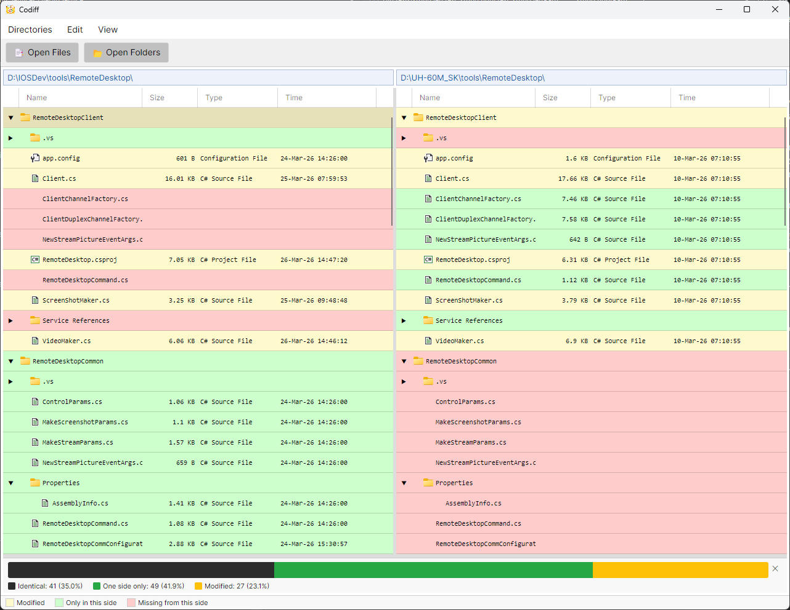
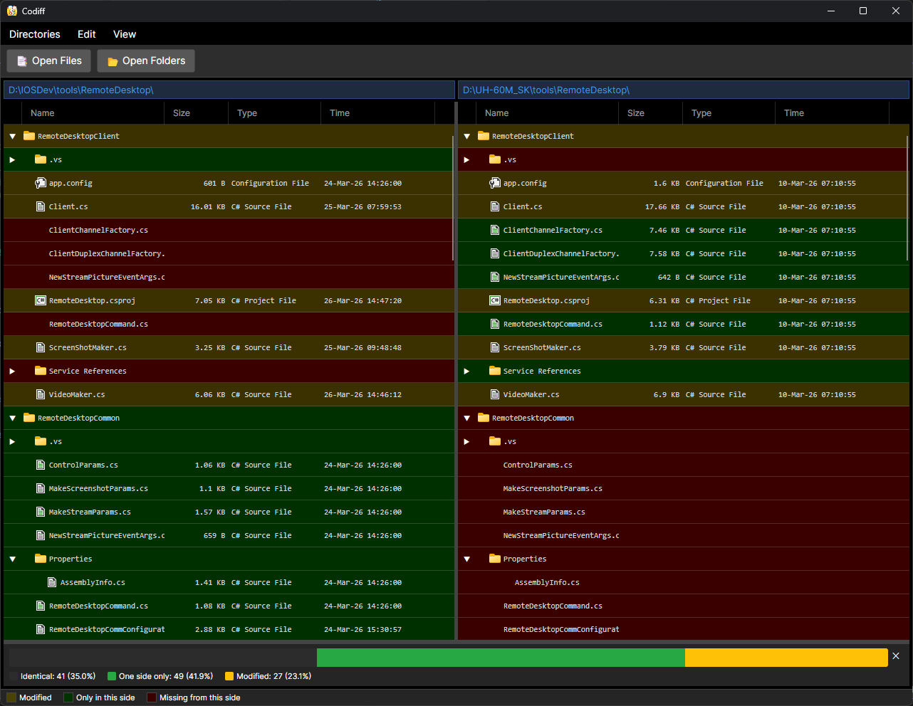

# Codiff

`Codiff` is a cross-platform desktop diff tool built with `Avalonia` and `.NET 10`.
It compares files and folders side by side with synchronized views, visual highlights, and quick navigation.



## Features

### File compare
- Side-by-side line diff for two files (or for a file that exists on one side only)
- Changed words highlighted inside modified lines
- Toolbar with first / previous / next / last difference; the current difference is marked
- Status bar: `Difference N of M`, counts of changed / added / deleted lines, encoding and line endings of both files
- Copy the current difference to the right or to the left (merge), with undo
- Recompare: re-reads files changed on disk, keeps unsaved edits
- Swap left and right
- Ignore white space and ignore case options
- Find (in the left or right file) and Go to line
- Inline editing on both sides; saving keeps each file's encoding (incl. BOM) and line endings
- Binary files are detected and reported as identical or different
- Export the differences as a unified diff (clipboard or `.diff` / `.patch` file that `patch` can apply)
- Side-by-side or top-bottom split
- Synchronized horizontal and vertical scrolling; large files stay fast (only visible lines are rendered)
- Clickable file paths to reveal files in the system file explorer
- Mini-map (`DiffMap`) for quick jump navigation through large diffs

### Folder compare
- Side-by-side folder comparison
- Tree view that focuses on differences
- Expand/collapse folders (`Expand All` / `Collapse All`)
- Sort by `Name`, `Size`, `Type`, and `Time`
- View modes: first directory only, second directory only, or both
- Double-click a file row to open a dedicated file diff window
- Actions for selected item:
  - Copy full path to clipboard
  - Delete from selected side
  - Delete from both sides
- Optional statistics panel (identical / one-side-only / modified)
- Filters: show identical files, different files, files only in the first or only in the second directory



### App behavior
- Light and dark theme toggle
- Recent comparisons menu (files and directories)
- Recent comparisons are persisted and can be cleared from the menu
- Directory convenience actions:
  - Re-compare
  - Swap directories
  - Move both sides up one folder level
- Start a comparison from the command line: `Codiff <left> <right>` (two files or two folders)
- Drag and drop two files or folders onto the window to compare them; drop a single one onto the left or right half to replace that side
- Errors (missing or unreadable files) are reported in a message instead of closing the application

### Keyboard shortcuts

| Action | Windows / Linux | macOS |
|---|---|---|
| Next / previous difference | `F8` / `Shift+F8`, `Alt+Down` / `Alt+Up` | same |
| First / last difference | `Alt+Home` / `Alt+End` | same |
| Copy difference to right / left | `Alt+Right` / `Alt+Left` | `Cmd+Option+Right` / `Cmd+Option+Left` |
| Undo copy | `Ctrl+Z` (outside a text field) | `Cmd+Z` (outside a text field) |
| Recompare (files and folders) | `F5` | `F5` |
| Save | `Ctrl+S` | `Cmd+S` (or `Ctrl+S`) |
| Find / find next / previous | `Ctrl+F` / `F3` / `Shift+F3` | `Cmd+F` / `F3` / `Shift+F3` |
| Go to line | `Ctrl+G` | `Ctrl+G` |

## Tech stack

- `.NET 10`
- `C#`
- `Avalonia 11`
- `CommunityToolkit.Mvvm`
- `DiffPlex`

## Getting started

### Prerequisites

- `.NET SDK 10`

### Run from source

```bash
dotnet run --project src/Codiff/Codiff.csproj

# compare two files or two folders right away
dotnet run --project src/Codiff/Codiff.csproj -- path/to/left path/to/right
```

## Usage

1. Start the application.
2. Choose `Open Files` or `Open Folders`.
3. Inspect differences using color highlights.
4. For file diffs, edit either side and press `Ctrl+S` to save.
5. For folder diffs, double-click a file row to open detailed file comparison.

## Configuration

Application settings are saved automatically in `config.json` in:
- Windows: `%AppData%\Codiff`
- macOS: `~/Library/Application Support/Codiff`
- Linux: `~/.config/Codiff`

The `CODIFF_CONFIG_DIR` environment variable points the settings to another folder (e.g. for a portable copy or automated tests).

Saved settings include:
- active theme
- recent comparisons (up to 10 entries)
- compare options (ignore white space, ignore case) and the split orientation
- which files the folder comparison shows (identical / different / only in one directory)