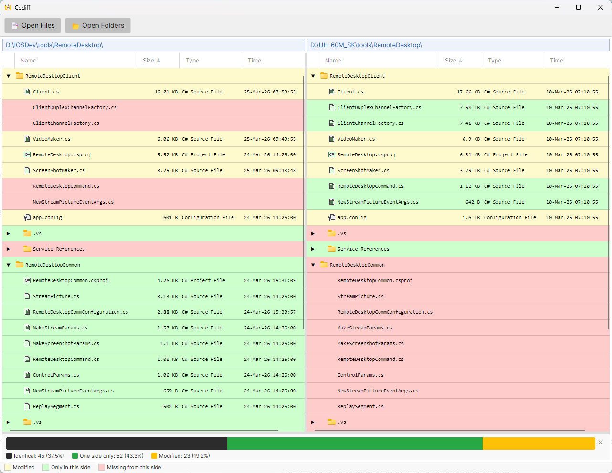

# Codiff

`Codiff` is a desktop diff tool built with Avalonia and .NET. It helps you compare files and folders side by side in a simple, visual way.



## Features

- File diff viewer
  - Side-by-side comparison of two files
  - Line numbers and synchronized scrolling
  - Quick navigation between change blocks
  - Save edited changes back to file (`Ctrl+S`)

- Folder diff viewer
  - Side-by-side folder comparison
  - Tree view with expandable folders
  - Double-click a file to open file diff
  - Sort by `Name`, `Size`, `Type`, and `Time`

- Color differencing
  - Highlighted modified lines
  - Clear indicators for one-side-only files
  - Diff map overview for fast navigation

- File and folder icons
  - File-type icons in folder compare view
  - Folder icons for directory nodes

- Useful extras
  - Open selected file/folder in system explorer
  - Comparison statistics panel for folder diffs

## Tech stack

- `.NET 10`
- `C#`
- `Avalonia UI`
- `CommunityToolkit.Mvvm`
- `DiffPlex`

## Getting started

### Prerequisites

- .NET SDK 10

### Run

```bash
dotnet run --project src/Codiff/Codiff.csproj
```

## Usage

1. Launch the app.
2. Click `Open Files` to compare two files, or `Open Folders` to compare two folders.
3. Review highlighted differences.
4. In file view, edit text and press `Ctrl+S` to save.
5. In folder view, double-click a file row to open a detailed file diff window.

## Notes

- The app is designed for desktop use.
- Icon extraction uses platform-specific APIs (best experience on Windows operating systems)